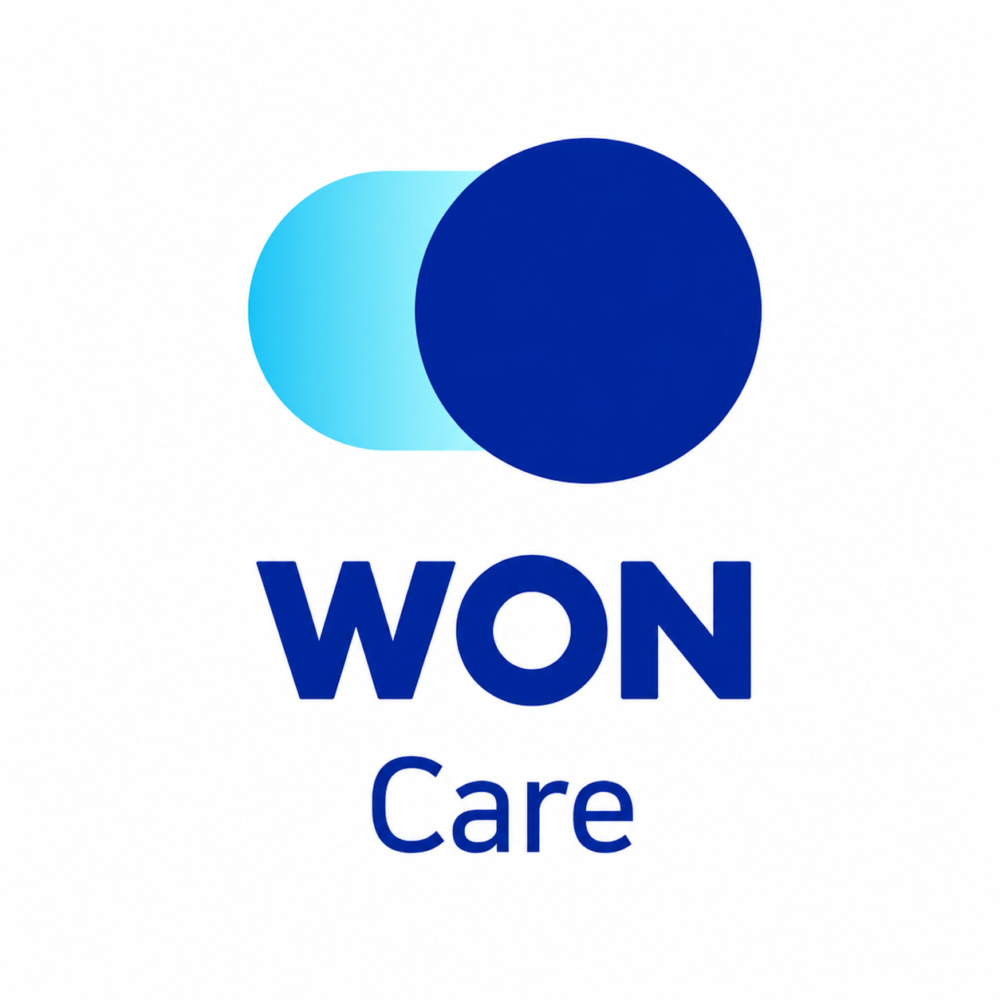
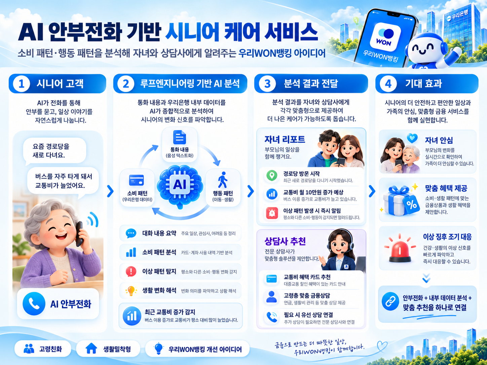
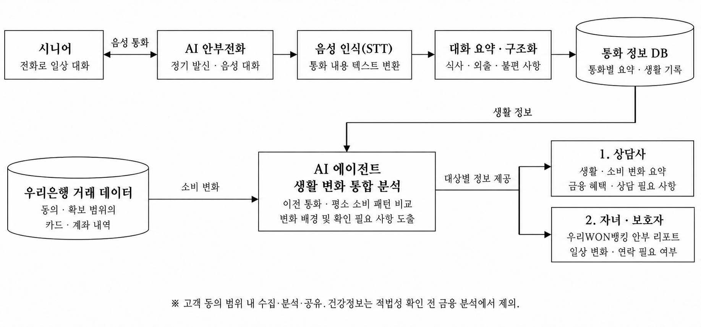

<div align="center">



# 우리WON케어

[](#팀-소개)
[](docs/woori-won-care-proposal.pdf)
[](index.html)
[](styles.css)
[](docs/woori-won-care-proposal.pdf)

### 익숙한 전화 한 통으로, 부모님의 일상에 더 가까이.

AI 안부전화와 동의한 금융·생활 정보 분석을 연결해<br />
시니어의 일상 변화를 살피고, 가족의 안부 확인과 금융상담을 돕는 서비스 제안입니다.

`AI 안부전화` · `루프 AI 에이전트` · `가족 안부 리포트` · `맞춤 금융상담`

[기획서 보기 · PDF](docs/woori-won-care-proposal.pdf) · [서비스 소개](#서비스-소개) · [주요 기능](#주요-기능) · [시스템 구성](#시스템-구성) · [문서 열어보기](#문서-열어보기)

</div>

<br />



## 서비스 소개

우리WON케어는 우리WON뱅킹을 고령 고객의 금융거래뿐 아니라 일상까지 함께하는 생활 밀착형 플랫폼으로 확장하기 위한 아이디어입니다.

정해진 시간에 AI가 안부전화를 걸어 식사·외출·관심사와 생활 속 불편을 듣습니다. 통화 기록과 적법하게 확보한 거래 정보를 개인의 평소 패턴과 비교하고, 확인이 필요한 변화를 다음 통화와 가족·상담사 안내로 연결합니다.

이 저장소는 **서비스 아이디어 기획서와 A4 문서용 HTML/CSS 소스**를 담고 있습니다. 아래 기능과 시스템 구성은 기획 내용이며, 실제 통화·은행 데이터 연동·AI 분석 서버의 구현을 의미하지 않습니다. README의 기획 내용은 [첨부한 5페이지 PDF](docs/woori-won-care-proposal.pdf)를 기준으로 정리했습니다.

## 어떤 문제를 풀고자 하나요?

| 문제 | 제안하는 접근 |
| --- | --- |
| 연락과 방문 사이에 부모님의 생활 변화를 놓치기 쉬움 | 익숙한 전화로 정기적으로 안부를 묻고 이전 통화와 비교 |
| 거래 내역만으로는 소비가 달라진 이유를 알기 어려움 | 대화 맥락과 동의·연계 범위의 소비 변화를 함께 확인 |
| 변화가 보여도 가족 확인이나 상담으로 이어지기 어려움 | 가족에게 확인 사항을, 상담사에게 생활비 부담과 금융 이용 불편을 전달 |

초기 대상은 우리은행 시니어 고객 중 혼자 살거나 자녀와 떨어져 지내는 고객입니다. 시니어는 별도의 앱 조작 없이 전화로 참여하고, 자녀·보호자는 공유에 동의한 안부 정보를 우리WON뱅킹에서 확인하는 흐름을 제안합니다.

## 주요 기능

| 기능 | 기획 내용 | 운영 기준 |
| --- | --- | --- |
| AI 안부전화·요약 | 설정 시간에 정기 통화하고 식사·외출·관심사·불편을 요약 | 이전 통화와 비교할 수 있도록 기록 |
| 루프 AI 에이전트 | 통화와 소비·행동 변화를 분석하고 다음 질문에 반영 | 개인의 평소 흐름과 비교하고 미확인 사항을 다시 질문 |
| 변화 감지·알림 | 평소와 다른 외출 언급이나 소비 변화 등 확인 신호 전달 | 단일 발화나 지출만으로 위험을 확정하지 않음 |
| 가족 안부 리포트 | 주요 대화·일상 변화·연락 필요 사항 제공 | 공유에 동의한 항목만 요약하고 전체 거래 내역 공개 지양 |
| 금융상담 연결 | 생활비·연금 관리와 금융 이용 어려움에 맞춘 상담 안내 | 필요 시 담당자가 재확인하고 전화상담으로 연결 |

### 예시: 교통비가 늘어난 이유를 함께 살피기

1. **대화에서 맥락 찾기** — 시니어가 “요즘 경로당을 새로 다녀요”라고 이야기합니다.
2. **소비 변화와 비교하기** — 동의한 거래 정보에서 최근 교통비 증가를 확인합니다.
3. **다음 통화로 보완하기** — 활동 변화와 관련이 있는지 질문하며 확인되지 않은 내용은 미확인으로 남깁니다.
4. **대상에 맞춰 안내하기** — 가족에게는 최근 일상과 확인 사항을, 상담사에게는 교통비 부담과 혜택 상담 필요 사항을 전달합니다.

## 시스템 구성



| 구성 | 기획서에서 검토한 역할 |
| --- | --- |
| 전화 연동 | 정기 발신, 음성 대화, 미응답·도움 요청 전달 |
| STT·TTS | 통화 내용을 텍스트로 변환하고 음성 응답 제공 |
| LLM·대화 구조화 | 식사·외출·불편 사항 추출, JSON 형식 검증, 요약 저장 |
| 루프 AI 에이전트 | 개인별 통화·소비·행동 변화 비교와 다음 질문 구성 |
| 우리WON뱅킹 | 참여 신청·공유 범위 설정·가족 리포트 접점 |
| 담당자 확인 | 분석 근거와 알림을 확인하고 필요한 후속 조치 수행 |

기획서는 한국어 음성 인식·합성 API와 전화 플랫폼을 조합하는 방안을 검토합니다. 구체적인 연동 범위와 운영 적합성은 고령층의 사투리·느린 응답·말 끊김을 포함한 실통화 검증이 필요합니다.

## 기획서의 정보 보호·운영 원칙

- **동의 범위에 따른 제공** — 수집·분석·가족 공유의 목적과 대상을 구분하고, 공유 대상 변경과 철회 기능을 마련합니다.
- **최소 정보 제공** — 가족에게는 동의한 안부 요약과 확인 사항을 전달하고, 상담사에게는 상담에 필요한 변화 근거를 제공합니다.
- **건강정보 결합 사전 검토** — 건강 대화와 금융정보의 결합은 포괄 동의만으로 추진하지 않고, 허용 목적과 적법성을 확인하기 전에는 금융 분석에서 제외합니다.
- **사람이 확인하는 후속 조치** — 에이전트 권한은 조회·분석·요약으로 제한하고, 금융상품 가입과 자금 이체는 자동 실행하지 않습니다.
- **미확인 정보 구분** — 정보가 부족하면 미확인으로 전달하며, 단일 신호로 건강 이상이나 위험을 단정하지 않습니다.

이는 기획서에 담긴 추진 조건입니다. 실제 사업화 전에는 법무·보안 심사와 데이터 연계 근거 확인이 필요하며, 의료진단이나 24시간 안전 확인을 보장하는 서비스로 제안하지 않습니다.

## 사업성 검토

기획서는 유료형과 은행 무료형을 나누어 검토합니다. 유료형은 실제 원가와 지불 의사를, 은행 무료형은 운영 예산 대비 고객 유지 효과를 실증하는 접근입니다.

### 유료형 비용 가정

| 항목 | 가정 | 1인·월 |
| --- | --- | ---: |
| 전화·AI | 월 8회 × 4분 × 200원/분 | 6,400원 |
| 후속 상담 | 8회 × 상담 전환 10% × 8분 × 400원/분 | 2,560원 |
| 알림·저장 | 월 정액 가정 | 1,000원 |
| **변동비 합계** | 전화·AI + 상담 + 알림·저장 | **9,960원** |
| 월 매출액 | 유료 가입자 1인당 가정 | 14,900원 |
| **기여이익** | 매출액 − 변동비 | **4,940원** |

위 수치는 **기획서의 검토용 가정**이며 확정 요금이나 실제 운영 성과가 아닙니다. 기여이익은 개발·보안·고정비 차감 전 금액입니다. 상담 전환율이 20%가 되면 변동비는 12,520원, 기여이익은 2,380원으로 달라집니다.

## 실증에서 확인할 것

| 검증 영역 | 주요 지표 |
| --- | --- |
| 통화·분석 품질 | 통화 완료율, STT 인식 오류율, LLM 추출 정확도, 요약 사실 일치, AI 도구 실행 성공률 |
| 변화 감지·후속 조치 | 분석 근거 일치, 이상 신호 오탐률, 담당자 확인 시간, 후속 조치와 다음 통화 기록 |
| 상담·운영성 | 상담 전환, 상담 시간·원가, 지속 이용, 지불 의사, 직원 업무시간 |

목표는 시니어에게 일상 대화 기회를 제공하고, 가족의 안부 확인을 보완하며, 생활·소비 변화에 맞는 상담으로 연결하는 것입니다. 효과는 시범 운영에서 확인하도록 기획했습니다.

## 문서 열어보기

### 기획서 PDF

**[우리WON케어 아이디어 기획서 보기 · A4 5페이지](docs/woori-won-care-proposal.pdf)**

| 페이지 | 내용 |
| --- | --- |
| 1 | 기획 취지와 서비스 개요 |
| 2 | 추진 배경, 문제 정의, 주요 기능 |
| 3 | 시스템 구성, 처리 흐름, 기술적 타당성 |
| 4 | 비용 가정, 경제적·시장 타당성 |
| 5 | 법적 검토·보호 원칙, 서비스 흐름, 실증 지표, 참고자료 |

통계·운영 사례·법령 등의 원문 출처는 PDF 마지막 페이지의 참고자료 링크에서 확인할 수 있습니다.

### HTML 문서

```bash
git clone https://github.com/jihyukboin/ssafy-woori-won-care.git
cd ssafy-woori-won-care
python3 -m http.server 8000
```

브라우저에서 <http://localhost:8000>을 엽니다. 별도의 패키지 설치나 빌드 없이 정적 HTML/CSS 문서를 확인할 수 있습니다. HTML 소스와 제출용 PDF는 별도로 관리하므로, 이 README에서 설명하는 기획 내용은 첨부 PDF를 기준으로 확인하세요.

문서 소스는 A4 세로 **210 × 297mm**, 로컬 Pretendard 폰트와 인쇄 스타일을 사용합니다. 인쇄·수정 시에는 A4 규격과 페이지별 레이아웃을 확인합니다.

## 프로젝트 구조

```text
ssafy-woori-won-care/
├── README.md                         프로젝트 소개와 기획 요약
├── index.html                        A4 기획 문서 HTML
├── styles.css                        문서 레이아웃·타이포그래피·인쇄 스타일
├── assets/
│   ├── won-care.webp                 서비스 로고
│   ├── service-overview.webp         서비스 개요 이미지
│   ├── system-architecture.webp      시스템 구성도
│   └── population-chart.webp         인구 통계 이미지
├── fonts/pretendard/                  로컬 폰트와 라이선스
└── docs/
    └── woori-won-care-proposal.pdf    아이디어 기획서
```

## 팀 소개

**SSAFY 서울 14반** · 강현준 · 김원석 · 정지혁

## 자료와 이용 안내

이 저장소는 우리WON뱅킹 개선을 제안하는 프로젝트의 기획 자료입니다. 우리은행의 공식 출시 서비스나 실제 은행 시스템과의 연동을 의미하지 않습니다.

- 기획 내용과 근거: [아이디어 기획서](docs/woori-won-care-proposal.pdf)
- Pretendard: [SIL Open Font License](fonts/pretendard/LICENSE)
- 외부 로고·브랜드·이미지·참고자료에는 각 권리자의 이용 조건이 적용됩니다.
